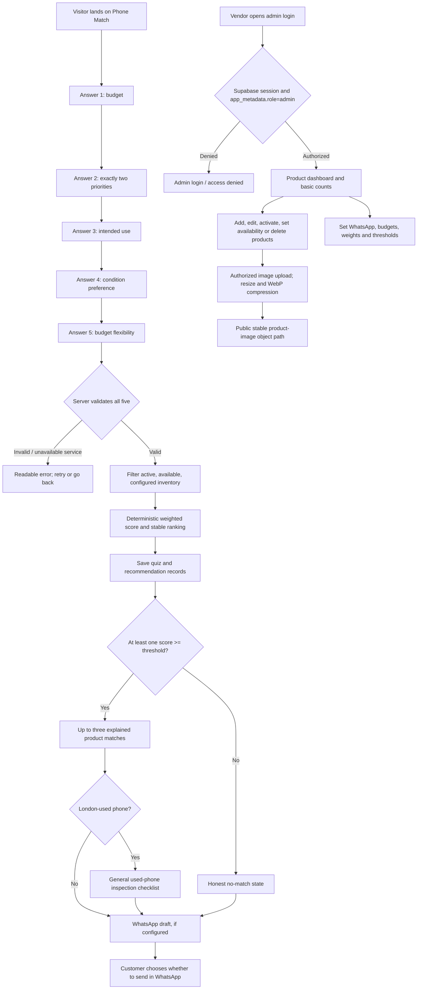
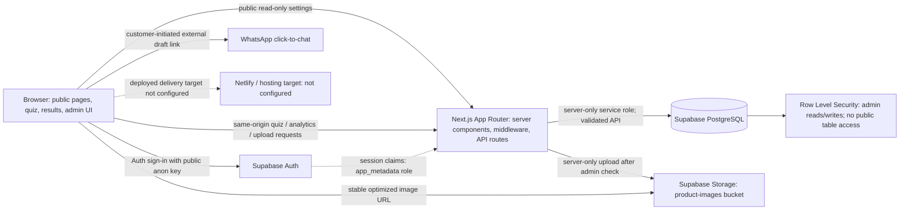

# Phone Match architecture (Phase 1)

## Scope and trust boundaries

Phone Match is a single-vendor, no-registration recommendation application. The browser receives the configured quiz options and an intentionally limited result payload. It never receives the Supabase service-role key, complete product matching ratings, database credentials, admin settings records, other quiz submissions or another user's result.

The service-role key is used only by server-only Next.js modules and route handlers. It bypasses RLS, so every privileged API route first validates its input, checks the session's immutable `app_metadata.role === "admin"` for administrator operations and, for mutations, requires a same-origin request. Public writes (quiz submission, recommendation and analytics) also use server-side validation and a per-process request limiter. The admin role is not read from editable `user_metadata`.

## Application layers

| Layer | Phase 1 responsibility |
|---|---|
| Presentation | Public landing, privacy notice, five-question quiz, result/no-match page, admin login, catalogue and settings screens |
| Application logic | `src/lib/quiz.ts` validation, `src/lib/recommendations.ts` deterministic scoring, `src/lib/whatsapp.ts` draft generation, server-side product validation and settings validation |
| Data | `products`, `quiz_submissions`, `recommendations`, `analytics_events`, `app_settings` |
| Infrastructure | Next.js routes and server components, Supabase PostgreSQL/Auth/Storage, environment template; no deployment is configured |

## Product and administrator journeys

## System and dependency diagram

## Database model and access

- `products` stores vendor-provided specifications, condition, availability, status, internal 1–5 matching attributes and usage suitability. Active/availability/price has an index.
- `quiz_submissions` stores only the five answers and creation time; there is no name, phone, email or IP column.
- `recommendations` links a submission to a product, retaining integer score, classification and explanation; foreign keys preserve product/recommendation history.
- `analytics_events` stores only allow-listed quiz-start, quiz-submit and WhatsApp-click names with optional product/submission references and timestamp.
- `app_settings` stores WhatsApp contact number, seven quiz budget ranges and scoring configuration as JSONB.
- All five tables enable RLS. Admin access checks `auth.jwt()->'app_metadata'->>'role' = 'admin'`. There are no anonymous table policies. Public requests use server routes and never return internal rating/suitability JSON.
- `product-images` is a public-read bucket for non-sensitive product photos, restricted to JPG/PNG/WebP and a 3 MB stored-file limit. Only the server-authorized administrator upload route writes objects.

Apply the initial schema from `supabase/migrations/202611210001_phase1_core.sql`. It adds tables/indexes/policies without deleting existing data. It is a first-install migration and has not been applied to a live project. Treat a rollback as a reviewed forward migration; dropping these tables after data exists would lose submissions and statistics.

## Performance and privacy choices

- The public config route uses a short shared-cache window; it returns budget options and a vendor-provided public phone number only.
- Recommendation queries load at most 500 active and available catalog records, ordered by price. Inventory admin UI displays the newest 100; it is not paginated yet.
- Product images are resized to a 1,600-pixel maximum edge and WebP-compressed before upload. Stable public storage URLs are optimized by `next/image`. There is no private-user-media flow.
- Quiz results live in the current browser tab's `sessionStorage` to support a separate results route and returning to edit answers. No customer account is required.
- Analytics does not retain IP addresses, names or contact data. The in-memory limiter temporarily uses the request's forwarded-address string as a local map key; it is neither shared across instances nor an abuse-proof boundary.
- `whatsappNumber` is blank by default. Configure a real business number through the admin settings after authenticating. The app does not claim a message was delivered.

## Unimplemented / follow-up

- Configure production Supabase, deploy only after release checks, and verify RLS against anonymous, non-admin and admin clients.
- Replace per-process rate limiting with the selected host's shared rate limiter before relying on it across serverless instances.
- Decide and implement quiz/submission retention; add a privacy contact channel.
- Add automated integration/E2E coverage and manual responsive/device verification against a configured project.
- Consider orphan image cleanup and product pagination if inventory usage demonstrates a need.
- Set a verified production canonical URL and validate Netlify's Next.js image/API behavior before launch.
